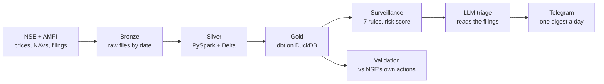
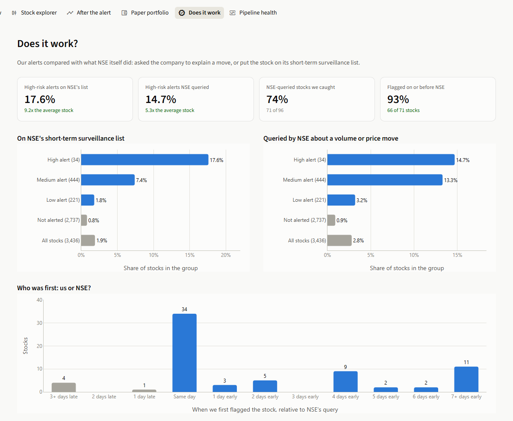
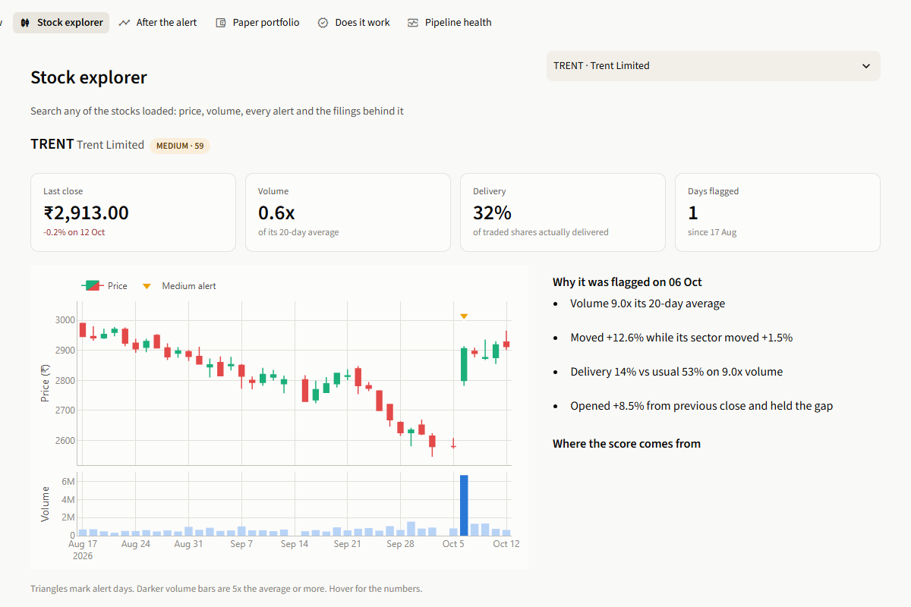

# India Market Intelligence and Surveillance Platform

A daily data pipeline on **real Indian market data** that flags unusual trading in NSE stocks,
explains each flag with company news, and checks its own alerts against what NSE itself acted on.

**The result:** over 15 trading days and 3,436 stocks, HIGH-risk alerts were **9x more likely than
an average stock to be on NSE's short-term surveillance list**, and the engine flagged **93% of the
stocks NSE queried on or before the day NSE queried them** (of those it flagged at all).



## What it does every trading day

1. **Extracts** the NSE bhavcopy (prices + delivery %), indices, corporate actions, company
   announcements, NSE's ASM / GSM surveillance lists and AMFI mutual fund NAVs.
2. **Cleans** them with PySpark into Delta tables: typed, deduplicated, idempotent `MERGE`, with
   prices adjusted for splits and bonuses so a 1:5 split is not read as an 80% crash.
3. **Models** a star schema with dbt on DuckDB (SCD2 stock dimension, facts, KPI marts for a
   portfolio: holdings, XIRR, SIP tracker, fund performance).
4. **Scores** every stock-day against 7 surveillance rules and attaches the company filings of the
   previous 3 days.
5. **Triages** each HIGH alert with an LLM that reads those filings and answers one question:
   does the news explain the move?
6. **Sends** one Telegram digest instead of ~85 raw alerts, and records data-quality checks.

## Surveillance engine

| Rule | Fires when |
|---|---|
| Volume spike | volume >= 5x its 20-day average, on at least Rs 1 cr traded |
| Price shock | moved >= 8% while its sector barely moved |
| Pump pattern | up >= 15% in 5 days on 2x volume with unusually low delivery |
| Dump after pump | sharp fall within 10 days of a pump pattern |
| Delivery anomaly | delivery % far from the stock's own norm on high volume |
| Circuit streak | 3+ consecutive closes at a price-band limit |
| Gap move | opened >= 5% away from the previous close and held it |

Rules are correlated (one news day trips volume, price and delivery together), so the risk score
is **the strongest rule plus half of the others**, plus a bump for thinly traded stocks, capped at
100. HIGH >= 70, MEDIUM >= 40. All thresholds live in `dbt/dbt_project.yml`.

### LLM triage: explanation, not detection

Detection stays rule-based and explainable. The LLM is only asked whether the filings behind a
HIGH alert account for it, and only when there *are* filings: with no news the answer is already
"unexplained", so most alerts cost zero API calls. Free-tier Groq or Gemini; any failure falls
back to a rule-based line, so the pipeline never depends on it.

| Alert | Triage line |
|---|---|
| Large-cap retailer, +12.6% on 9x volume | Explained: Q2 FY27 business update likely drove the surge |
| Small-cap, +15% | Unexplained: CFO resignation unlikely to drive a 15% rise |
| Small-cap, +8.5% | Unexplained: routine dividend tax intimation |

### A day's digest

```
NSE surveillance: 06 Oct 2026
87 flagged · 2 HIGH · 52 MEDIUM

HIGH (2)
• <SYMBOL> (73)
  Volume 47.5x its 20-day average; Moved +16.6% while its sector moved +0.8%;
  Delivery 20% vs usual 70%; Thinly traded (avg turnover Rs 0.07 cr/day)
  No company news in the last 3 days: worth a look

Watchlist: top 10 new MEDIUM names
• <SYMBOL> (60) volume_spike, price_shock, delivery_anomaly · NSE query
• <SYMBOL> (59) volume_spike, price_shock, gap_move · news: results
```

## Does it work? Validation against NSE

NSE publishes two things that act as ground truth: **exchange queries** asking a company to explain
a volume or price move, and its **short-term ASM list** of stocks under additional surveillance.
`mart_surveillance_validation` compares every alert band with both (21 Sep - 12 Oct 2026).

| Our alert level | Stocks | Queried by NSE | On short-term ASM |
|---|---|---|---|
| **HIGH** | 34 | 14.7% (**5.3x**) | 17.6% (**9.2x**) |
| MEDIUM | 444 | 13.3% (4.8x) | 7.4% (3.9x) |
| LOW | 221 | 3.2% (1.1x) | 1.8% (0.9x) |
| Not alerted | 2,737 | 0.9% | 0.8% |
| All stocks | 3,436 | 2.8% | 1.9% |

- **Recall:** 74% of the 96 stocks NSE queried, and 65% of the 66 on short-term ASM, had an alert.
- **Timing:** of 71 queried stocks we flagged, 32 were flagged before NSE's query, 34 the same day,
  5 after.
- **Ablation:** per-stock z-score baselines ("unusual for *this* stock") were tested against the
  flat rules and agreed with NSE *less*; the flat rules stayed. See
  [docs/baseline_ablation.md](docs/baseline_ablation.md).

**Limits, stated plainly.** Three weeks of data and 34 stocks in the HIGH band, so the multiples
will move. NSE's own triggers are based on volume and price moves too, so some agreement is
expected: this shows the engine matches NSE's screening, not that any stock was manipulated. NSE
publishes no history for its lists, so the pipeline snapshots them daily; lead time against the
lists becomes measurable as that history builds.

**Surveillance flags are analytical signals, not accusations.**

## Stack

| Layer | Tool |
|---|---|
| Extraction | Python + requests (NSE session handling, retries, yfinance fallback) |
| Lake | Bronze raw files and Silver Delta tables, on local disk or MinIO (S3) |
| Processing | PySpark 4 + Delta Lake (idempotent MERGE, split / bonus adjustment) |
| Warehouse and modelling | DuckDB + dbt: staging -> intermediate -> marts, SCD2 snapshot |
| Surveillance | dbt SQL rules, thresholds as project vars |
| Triage | Groq / Gemini free tier over plain HTTPS, cached, with rule-based fallback |
| Alerts | Telegram Bot API |
| Dashboard | Streamlit + Plotly, in its own virtual environment |
| Orchestration | `src/pipeline/daily.py` (7 steps, run log, resume from any step) on Windows Task Scheduler |
| Quality | 51 dbt tests (47 data + 4 unit), 33 pytest tests, pipeline checks in `ops.dq_results`, GitHub Actions |

## Run it

Needs Python 3.11+ and Java 17. On Windows, Spark also needs `HADOOP_HOME` with `winutils.exe`.

```bat
copy .env.example .env
:: in .env set LAKE_BACKEND=local  (no Docker needed)
pip install -r requirements.txt
python -m src.extractors.cli --start 2026-08-17 --end 2026-10-06 --source nse
python -m src.extractors.cli --date 2026-10-06 --source amfi
python -m src.extractors.cli --date 2026-10-07 --source corp_actions
python -m src.extractors.cli --date 2026-10-07 --source reference
python -m src.extractors.cli --date 2026-10-07 --source mfapi
python -m src.extractors.cli --start 2026-09-14 --end 2026-10-07 --source announcements
python -m src.spark_jobs.silver --all
dbt build --project-dir dbt --profiles-dir dbt
pytest
```

Then one command per day (or schedule `scripts/run_daily.ps1`, which also catches up missed days
and reports failures on Telegram):

```bat
python -m src.pipeline.daily                                  :: today
python -m src.pipeline.daily --date 2026-10-06 --from-step silver   :: resume
```

Optional keys in `.env`: `TELEGRAM_BOT_TOKEN` + `TELEGRAM_CHAT_ID` for the digest (written to
`logs/` without them), `GROQ_API_KEY` or `GEMINI_API_KEY` for LLM triage.

Use your own portfolio without committing it: put it in `data/local/portfolio.csv` and set
`PORTFOLIO_CSV=data/local/portfolio.csv`.

## Dashboard

```bat
powershell -ExecutionPolicy Bypass -File scripts\dashboard.ps1     :: opens http://localhost:8501
```

A Streamlit app on the Gold tables. Hover any dot or bar for its details; click a dot or a table
row to open that stock. It is read-only and never holds the warehouse open, so the daily run is
not blocked.



| Page | What it shows |
|---|---|
| Overview | A market map of every flagged stock (price move against volume, sized by score), the high-risk alerts with their news check, and a filterable table |
| Stock detail | Candlesticks and volume with alert days marked, why it was flagged, **the score broken down by rule**, the filings, and a paper-invest button |
| After the alert | Simulate buying the day after every alert and holding N days, against the median stock |
| Paper portfolio | Virtual positions and their profit or loss |
| Does it work | The comparison with NSE's queries and surveillance list, and who was first |
| Pipeline health | Data freshness, step timings, run log and data-quality checks |



"After the alert" is the engine's most direct check: over 21 Sep - 12 Oct, a stock bought at the
open after a HIGH alert was **down 10.9% on average five trading days later**, and only 17% of them
rose (24 alerts). That is what a pump-and-dump screen should find, on a small sample. The paper
portfolio and the simulator use virtual money on past data; nothing here is investment advice.

## Data model

**Silver** (Delta): `stock_daily`, `stock_daily_adjusted`, `corporate_actions`, `announcements`,
`surveillance_lists`, `index_daily`, `fund_nav`, `fund_nav_history`, `stock_master`.

**Gold** (dbt, schema `gold` in `data/warehouse/market.duckdb`; DuckDB reads Delta in place, so
there is no copy step between Silver and Gold):

| Model | What it is |
|---|---|
| `dim_date`, `dim_stock`, `dim_fund`, `dim_index` | Calendar with Indian FY and NSE holidays; SCD2 stock master |
| `fact_stock_daily` | Adjusted OHLCV, delivery %, returns, 20-day volume / delivery / volatility |
| `fact_index_daily`, `fact_fund_nav`, `fact_portfolio_txn` | Index levels, NAVs, signed cash flows |
| `fact_surveillance_alert` | One row per flagged stock-day: score, band, rules, reason, news context |
| `mart_surveillance_validation` | Hit rate and lift of each alert band against NSE's actions |
| `mart_portfolio_holdings`, `mart_portfolio_xirr`, `mart_sip_tracker` | P&L, XIRR, SIP regularity |
| `mart_fund_performance`, `mart_sector_performance` | Returns, Sharpe, drawdown; sector breadth |

## Roadmap

- Train a model on the ASM-inclusion labels once a few weeks of daily list snapshots exist.
- Read the filing PDFs, not just NSE's one-line summary, in the triage step.
- Host the dashboard publicly on a sample of the data.

A Docker / Airflow / Postgres variant of this project lives in
[india-market-surveillance-platform](https://github.com/chehakmiglani/india-market-surveillance-platform).
